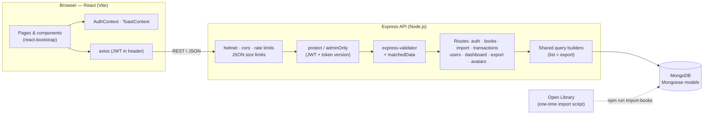

# Stacks — Library Management System

A full-stack library management system built with the **MERN** stack (MongoDB, Express, React, Node.js) for the **Advanced Web Programming** course. Librarians use Stacks to manage the catalog, lend and receive books, handle members' borrow requests, look after member accounts, and export or bulk-import records. Members get a Facebook-style portal to discover books, save them, request them, and follow their own borrowing. The design follows the **NU MOA** school theme (NU blue `#3D398C`, NU gold `#F5DA3E`, Poppins), and users can switch to seven other colour themes.

**Team:** John Jacob C. Casiple · Elijah

---

## Contents
- [Features](#features)
- [Roadmap](#roadmap)
- [Tech stack](#tech-stack)
- [Architecture](#architecture)
- [Folder structure](#folder-structure)
- [Getting started](#getting-started)
- [Scripts](#scripts)
- [API reference](#api-reference)
- [Security](#security)
- [Requirements coverage](#requirements-coverage)
- [Screenshots](#screenshots)
- [Data credits](#data-credits)

---

## Features

**Dashboard**
- Stat cards with trends, a borrowed-vs-returned chart (7 / 30 / 90 days), and status and category donuts.
- "Returning soon" and "Late returns to follow up" lists, plus "Most borrowed" and "Recent activity" (the audit log).
- All days are grouped in Philippine time (Asia/Manila).

**Books**
- 1,000 real titles with fast search (all fields or one field).
- Filters: category, availability, author, language, year range, length, publisher, shelf, copies and date added. Filters are saved in the URL, so a filtered view can be shared or bookmarked.
- Table or card view, column picker, pagination (10 / 20 / 50 / 100) and skeleton loading.
- Book details modal with a zoomable cover and the current borrowers.
- Add / edit / delete with live character limits, unsaved-changes warnings and cover photo upload (resized in the browser, checked by its real file type on the server).
- **Bulk upload** from CSV or Excel: downloadable template, a preview of every row (ready / already in library / duplicate in file / errors / warnings), an error report, and the import.

**Transactions** (borrowing)
- Lend a book with member and book search, return it, or extend the return date (up to 2 times).
- Status tabs with counts: Active, Returning soon, Late, Returned. Statuses are calculated from the dates, never stored.
- Late books cannot be extended, and a member with a late book cannot borrow more until it is returned.
- Books with borrowing history are **archived** (hidden but kept in the records, restorable) instead of deleted; members with history can only be deactivated.
- Rules: at most 5 books per member, never two copies of the same book, and a copy must be available.

**Members**
- Add, edit, activate / deactivate, delete, and set a new password (which signs the member out everywhere).
- Library card numbers (`LIB-2026-0001`), borrowing history, login activity (device and time) and librarian-only notes.

**Selection and export** (Books, Members, Transactions)
- Checkboxes on rows and cards, shift+click ranges, "Select all 1,000 matching", and a selection bar.
- Export to **CSV**, **Excel** (styled header, frozen row, filters, real dates, a "Report info" sheet) or **PDF** (A4 landscape, repeating header, page numbers, embedded Noto Sans for "ñ" and accented letters).
- Scope: selected rows, the current page, or everything matching the current filters.

**Requests** (librarians)
- Members' borrow requests with status tabs (Pending, Approved, Denied, Cancelled, Expired, All), search, sort, stat cards and a pending badge in the sidebar.
- **Approve** at the counter: the server checks every rule again and creates the transaction (14 days). **Deny** with an optional note for the member.

**Settings**
- Profile (photo, name, contact, address), Appearance (8 colour themes with preview) and Security (change password, recent logins, sign out other devices).

### Member portal (Facebook-style)
- **Top bar** with search, Home / Bookmarks / My Books / Profile tabs, a notification bell and an account menu; on phones the tabs move to a bottom bar.
- **Home feed**: books as "posts" with infinite scroll (10 at a time). The order is reshuffled on every visit and when Home is clicked again. Filters: available now and category. Search by title, author or ISBN.
- **Side columns**: "New arrivals" (7 / 30 days) and "Most borrowed" (this week / month).
- **Book modal**: every detail, the shelf to find it on, Bookmark, and **Request**. The button explains why it is disabled (late book, 5-book limit, no copies) and shows "Requested" or "You're borrowing this" when that applies.
- **Bookmarks** with infinite scroll and Undo.
- **My Books**: Borrowed (return dates, late warning), Requests (status, librarian's note, cancel) and History (with a summary), each with "Load more".
- **Notifications**: approved / denied / expired requests, return reminders, late books and a weekly "new books" digest. Unread badge, mark as read, and a full page.
- **Profile**: header card with counts + the same profile, theme and security settings as librarians.

### Request workflow
1. A member presses **Request**. The server checks the rules: active member, no late books, not already borrowing or requesting it, a copy available, and borrowed + pending < 5.
2. The request is **pending** for 3 days (until the end of the 3rd day). The member picks the book up at the counter.
3. The librarian **approves** it (the server re-checks everything and creates the transaction) or **denies** it with an optional note. Members can cancel while pending.
4. A request nobody handles **expires** after 3 days (marked automatically the next time requests are read).
5. Every step notifies the member and is written to the activity log.

## Roadmap
- **Reservations queue**: join a waiting list for a book whose copies are all borrowed.
- **Late fines + library policy settings**: loan days, max books, max extensions and the fine per day, editable by librarians.
- **Lost / damaged books**, **closed days / holidays** for return dates, and a **full activity log page**.

## Tech stack

| Layer | Technology | Used for |
|---|---|---|
| Database | MongoDB + Mongoose 8 | Users, books, transactions, activity log, photos and covers |
| API | Node.js + Express 4 | REST API |
| Validation | express-validator 7 | Checks and whitelists every input (body, params, query) |
| Auth | jsonwebtoken + bcryptjs | JWT login tokens, hashed passwords |
| Security | helmet, cors, express-rate-limit | Security headers, allowed origin, brute-force protection |
| Files | multer, exceljs, pdfkit | Uploads, Excel import/export, PDF export |
| Frontend | React 18 + Vite 5 | Single-page app |
| Routing | React Router 6 | Pages, protected routes, filters in the URL |
| UI | Bootstrap 5.3 + react-bootstrap 2.10 | Layout and components, themed with CSS variables |
| Charts | Recharts 3 | Dashboard charts |
| Icons | lucide-react | Icons |
| HTTP | axios | API calls with the JWT attached automatically |

## Architecture



## Folder structure

```text
library-mern/
├── client/                     React app (Vite)
│   ├── public/covers/          1,000 book covers ({isbn}.jpg)
│   └── src/
│       ├── api.js              axios instance (JWT + auto logout on 401)
│       ├── App.jsx             routes
│       ├── context/            AuthContext, ToastContext, MemberContext
│       ├── layouts/            AdminLayout (sidebar), MemberLayout (Facebook-style top bar)
│       ├── hooks/              useListQuery, useUrlFilters, useSelection, usePagedList, useThemeColors, ...
│       ├── components/         shared UI + books/, members/, transactions/, table/, dashboard/, settings/
│       ├── pages/              Login, Register, admin/ (Dashboard, Books, Requests, ...), member/ (Home, Bookmarks, MyBooks, Profile, Notifications)
│       ├── styles/admin.css    layout and component styles
│       ├── index.css           design tokens and the 8 colour themes
│       └── utils/              formatting, labels, limits, downloads, CSV
├── server/                     Express API
│   ├── assets/fonts/           Noto Sans (PDF export) + its licence (OFL.txt)
│   ├── data/books.json         the 1,000 books (from Open Library)
│   ├── export/                 CSV, Excel and PDF writers + column lists
│   ├── import/                 file reading and row validation (bulk upload)
│   ├── middleware/             auth, validation/errors, timing
│   ├── models/                 User, Book, Borrow, ActivityLog, LoginActivity, ...
│   ├── queries/                filters and sorts shared by lists and exports
│   ├── routes/                 one file per API area
│   ├── scripts/                importBooks, reset, backfill
│   ├── utils/                  limits, ISBN, Manila dates, activity log, ...
│   ├── seed.js                 deterministic demo data
│   └── server.js               app setup
├── docs/screenshots/           screenshots for this README
└── README.md
```

## Getting started

### Requirements
- Node.js 18 or newer
- MongoDB (local, or a free MongoDB Atlas cluster)

### 1. Install
```bash
cd server && npm install
cd ../client && npm install
```

### 2. Environment variables
Create `server/.env` (it is git-ignored, never commit it):

| Variable | Example | Purpose |
|---|---|---|
| `MONGO_URI` | `mongodb://127.0.0.1:27017/stacks` | Database connection string |
| `JWT_SECRET` | `change-me-to-a-long-random-string` | Signs the login tokens (keep it secret) |
| `JWT_EXPIRES_IN` | `7d` | How long a login lasts (default `7d`) |
| `CLIENT_URL` | `http://localhost:5173` | The only website allowed to call the API (CORS) |
| `PORT` | `5000` | API port (default `5000`) |
| `TZ` | `Asia/Manila` | Server time zone, so return dates end at midnight in the Philippines |
| `OPENLIBRARY_CONTACT` | `your-email@example.com` | Contact sent to Open Library by the one-time import script |

The client needs no `.env` in development: Vite forwards `/api` to `http://localhost:5000`. For a deployed client, set `VITE_API_URL` (for example `https://your-api.example.com/api`).

### 3. Demo data
```bash
cd server
npm run seed    # WARNING: deletes and recreates every collection
```
The seed always creates the same data: 1,000 books, 31 users and about 300 transactions over the last 90 days, plus an activity log.

### 4. Run
```bash
cd server && npm run dev     # API on http://localhost:5000
cd client && npm run dev     # app on http://localhost:5173
```

### Demo accounts
| Role | Email | Password |
|---|---|---|
| Librarian | `admin@gmail.com` | `admin123` |
| Librarian | `librarian2@gmail.com` | `admin123` |
| Member (no late books, has requests, bookmarks and notifications) | `member@gmail.com` | `member123` |
| Member (has a late book, so requesting is blocked) | `juan@gmail.com` | `member123` |
| Member (deactivated) | `maria@gmail.com` | `member123` |

These are demo passwords for a local database only.

## Scripts

| Folder | Command | What it does |
|---|---|---|
| `server` | `npm run dev` | API with auto-restart (nodemon) |
| `server` | `npm start` | API (production) |
| `server` | `npm run seed` | Deletes everything and loads the demo data |
| `server` | `npm run reset` | Empties the database |
| `server` | `npm run backfill` | Adds missing member IDs / transaction codes / extension counts / feed order to older data |
| `server` | `npm run import-books` | One-time download of books and covers from Open Library (already done; the results are in the repo) |
| `client` | `npm run dev` | Development server |
| `client` | `npm run build` | Production build in `client/dist` |
| `client` | `npm run preview` | Serves the production build locally |

## API reference

All paths start with `/api`. **protect** = logged in; **admin** = logged-in librarian.

| Method | Path | Access | Description |
|---|---|---|---|
| POST | `/auth/register`, `/auth/login` | public (rate limited) | Create an account / log in (returns a JWT) |
| GET | `/auth/me`, `/auth/logins` | protect | Current user; last 5 logins |
| PUT | `/auth/profile`, `/auth/preferences` | protect | Name, contact, address; colour theme |
| PUT | `/auth/password` | protect (10 / 15 min) | Change password (signs out other devices) |
| PUT / DELETE | `/auth/avatar` | protect | Upload / remove profile photo |
| GET | `/avatars/:key` | public | Profile photo (random, unguessable key) |
| GET | `/dashboard?range=7\|30\|90` | admin | Everything the dashboard shows |
| GET | `/books`, `/books/facets`, `/books/authors`, `/books/:id` | protect | Search/filter/sort/paginate; filter options; author suggestions; details |
| POST / PUT / DELETE | `/books`, `/books/:id` | admin | Add / edit / delete a book (delete only without borrowing history) |
| PUT | `/books/:id/archive`, `/books/:id/restore` | admin | Archive (hide, keep records) / restore a book |
| PUT / DELETE | `/books/:id/cover` | admin | Upload / remove a cover photo |
| GET | `/books/:id/cover` | public | Uploaded cover image |
| GET | `/books/import/template?format=csv\|xlsx` | admin | Bulk upload template |
| POST | `/books/import/preview` | admin (10 / 10 min) | Check a CSV/XLSX file; saves nothing |
| POST | `/books/import/commit` | admin (10 / 10 min) | Re-check and save the ready rows |
| GET | `/transactions`, `/transactions/stats`, `/transactions/:id` | admin | List with status tabs; numbers; details |
| POST | `/transactions` | admin | Lend a book |
| PUT | `/transactions/:id/return`, `/transactions/:id/renew` | admin | Return; extend the return date |
| GET | `/users`, `/users/stats`, `/users/:id` | admin | Members list; numbers; details with history |
| POST / PUT / DELETE | `/users`, `/users/:id` | admin | Add / edit (incl. activate/deactivate) / delete (only without borrowing history) |
| PUT | `/users/:id/password` | admin | Set a member's password |
| POST | `/export/books\|members\|transactions` | admin (20 / 10 min) | Download CSV / Excel / PDF |
| GET | `/stats` | admin | Shared library numbers (same helper as the Dashboard and Transactions) |
| GET | `/requests?status=&search=&sort=&page=&limit=`, `/requests/stats`, `/requests/:id` | admin | Requests list with tab counts and "can approve now"; numbers; details |
| PUT | `/requests/:id/approve`, `/requests/:id/deny` | admin | Approve (creates the transaction) / deny with an optional note |
| POST | `/requests` | member (20 / hour) | Request a book (`{ bookId }`) |
| PUT | `/requests/:id/cancel` | member | Cancel your own pending request |
| GET | `/feed?seed=&page=&limit=&search=&category=&available=` | protect | Member Home feed (shuffled per seed, or searched) |
| GET | `/member/highlights?newRange=7\|30&popularRange=week\|month` | protect | New arrivals + most borrowed (cached 60 s) |
| GET | `/me/summary`, `/me/book-status/:bookId` | member | Badges and counts; what the book modal shows |
| GET / POST / DELETE | `/me/bookmarks`, `/me/bookmarks/:bookId` | member | Your bookmarks |
| GET | `/me/borrowed`, `/me/requests`, `/me/history` | member | My Books tabs |
| GET / PUT | `/me/notifications`, `/me/notifications/unread-count`, `/me/notifications/:id/read`, `/me/notifications/read-all` | member | Your notifications |
| GET | `/health` | public | Health check |

Every `/me` endpoint uses the logged-in user from the token (`req.user._id`); no endpoint accepts a user id from the browser, so members only ever see and change their own data.

## Security
- **Passwords**: hashed with bcrypt (cost 10); the hash field uses `select: false`, so it is never loaded unless asked for, and it is removed from every aggregation.
- **Login tokens (JWT)**: they carry a token version, so changing a password signs out every other device at once. Deactivated users are rejected on their next request.
- **Roles**: `protect`, `adminOnly` and `memberOnly` middleware on every private route. Member endpoints only read or write the logged-in member's own data and never return admin-only data (other borrowers, notes, IPs, archived books).
- **Input validation**: express-validator checks every body, parameter and query value, and `matchedData` keeps only the whitelisted fields, so fields like `availableCopies` or `role` cannot be smuggled in.
- **Injection**: search text is regex-escaped; sorts and filters are whitelisted keys (user input never reaches `.sort()` or a field name); operator objects such as `{"$gt": ""}` are rejected.
- **Rate limits**: login: 10 failed attempts per 15 min per IP + email and 50 failed per IP (the answer says how many minutes are left); register 20 / hour per IP; password change 10 / 15 min; export 20 / 10 min per librarian; import preview/commit 10 / 10 min each.
- **Data retention**: login records (with IP addresses) are deleted automatically after 90 days (TTL index, RA 10173). The audit trail is kept.
- **Request size**: JSON bodies are capped at 10 KB, except the export (300 KB, for up to 10,000 selected ids) and the import commit (3 MB).
- **Uploads**: size limits, and the real file type is checked from the first bytes (magic bytes), so a renamed file is rejected. This covers covers, photos and import files.
- **Spreadsheet safety**: CSV cells starting with `= + - @` get a leading apostrophe (formula injection), and Excel cells are always written as text, never as formulas.
- **Privacy (RA 10173, Data Privacy Act)**: exports never contain password hashes, token versions, photo keys or IP addresses.
- **Headers**: helmet security headers; CORS allows only `CLIENT_URL`.
- **Secrets**: kept in `server/.env`, which git ignores.

## Requirements coverage

| Requirement | Where it is met |
|---|---|
| **User Management** | Register/login with JWT; librarian and member roles; member CRUD, activate/deactivate, set password; profile, photo and password settings (members and librarians); login history |
| **Dashboard** | Librarians: `/admin` with stat cards, charts (Recharts), returning-soon and late lists, most borrowed, recent activity, pending-requests pill. Members: Home feed with New arrivals / Most borrowed columns and a profile header with their counts |
| **CRUD** | Books (plus cover upload and bulk import), members, transactions (lend, return, extend), borrow requests (create, cancel, approve, deny) and bookmarks (add, list, remove), all validated on client and server |
| **React features** | Function components with props and state; hooks (`useState`, `useEffect`, `useMemo`, `useRef`, `useCallback`); custom hooks (`useListQuery`, `useUrlFilters`, `useSelection`, `usePagedList` + `useSentinel` for infinite scroll, `useUnsavedChanges`); Context (auth, toasts, member portal); React Router (nested layouts, protected routes per role, URL state); lazy loading; controlled forms with validation |
| **API integration** | REST API consumed with axios (interceptors for the JWT and auto logout); polling for notifications; Open Library API used by the import script; file downloads (blobs) |
| **Security** | See [Security](#security): bcrypt, JWT, `protect` / `adminOnly` / `memberOnly`, express-validator on every input, own-data-only member endpoints, rate limits, upload checks, privacy |
| **UI** | Bootstrap 5.3 + react-bootstrap; responsive from 375 px phones to 1920 px screens (Facebook-style top bar + bottom tabs on phones for members); navigation menus; search; numbered pagination, infinite scroll and "Load more"; 8 colour themes; skeleton loading, toasts, empty states, accessible labels and keyboard support |

## Screenshots
Screenshots go in [`docs/screenshots/`](docs/screenshots/).

| Dashboard | Books | Transactions |
|---|---|---|
|  |  |  |

| Members | Export | Bulk upload |
|---|---|---|
|  |  |  |

## Data credits
Book details and cover images come from **[Open Library](https://openlibrary.org/)** (Internet Archive), downloaded once with `npm run import-books` while following their API guidelines (identified User-Agent, rate limited). Open Library publishes its catalog data under the CC0 public domain dedication; the covers come from the Open Library Covers API. PDF exports embed **Noto Sans** (SIL Open Font License 1.1, see `server/assets/fonts/OFL.txt`).
